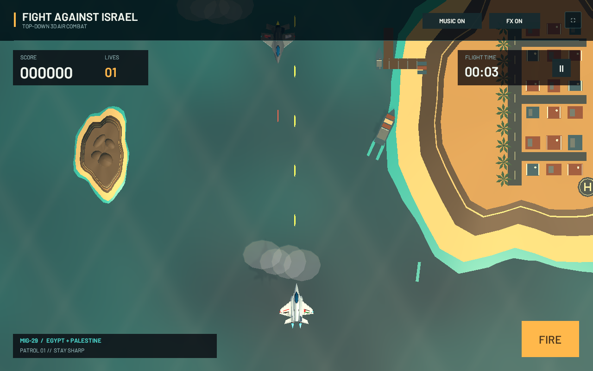

# Fight against Israel

[Play in your browser](https://shohdi.github.io/fight-against-israel-unity/) | [Download for Windows](https://github.com/shohdi/fight-against-israel-unity/releases/latest)

A standalone Unity top-down 3D fighter game. It preserves the original JavaScript game's fixed overhead camera, movement, shooting, enemy waves, and one-life survival loop, with new aircraft geometry, lighting, effects, music, and sound.

- Player: a MiG-29-inspired aircraft with Egypt and Palestine wing flags.
- Enemies: F-35-inspired aircraft with Israel and US wing flags.
- Real-time 3D aircraft, ocean scenery, shadows, engine glow, projectiles, and explosions.
- Keyboard and pointer/touch controls, a score display, and restartable rounds.

The aircraft are original stylized representations built for this game.



## Controls

| Action | Control |
| --- | --- |
| Move | WASD or arrow keys |
| Fire | Space |
| Move on touch/pointer | Drag the player aircraft |
| Fire on touch/pointer | On-screen fire control or tap/click away from the aircraft |
| Start or restart | Enter or the on-screen button |
| Pause or resume | P or Escape |
| Toggle music | M |

The game displays its controls and round actions on screen. Survive enemy attacks and shoot down enemy fighters to increase your score.

## Open the Unity project

1. Install **Unity 6000.2.6f1** through Unity Hub. Add Windows Build Support and WebGL Build Support for the targets you want to build.
2. Clone this repository and add its root folder as a Unity project in Unity Hub.
3. Open the project and allow Unity to import the assets.
4. Open `Assets/Scenes/AirCombat.unity`. If the scene needs to be generated, choose **Fight against Israel > Prepare scene**.
5. Press **Play** in the Unity editor.

The project uses Unity's built-in render pipeline. No paid asset packages are required.

## Build

Use **Fight against Israel > Build Windows** to create `Builds/Windows/FightAgainstIsrael.exe`, or **Fight against Israel > Build WebGL** to create the browser build in `docs/`.

Command-line builds use the editor method `FightAgainstIsrael.Editor.GameBuilder.BuildWindows` or `FightAgainstIsrael.Editor.GameBuilder.BuildWebGL` with Unity's `-batchmode -quit -projectPath` and `-executeMethod` arguments.

Serve a WebGL build through an HTTP server; opening its HTML directly from disk is not supported. With Node.js installed, run the included server from the project root:

```sh
node Tools/serve.cjs
```

Open `http://localhost:8080`. An optional port argument is supported, for example `node Tools/serve.cjs 9000`. The server requires no npm packages.

## Gameplay smoke check

The Windows build includes an automated gameplay check. From the project root in PowerShell:

```powershell
New-Item -ItemType Directory -Path Logs -Force | Out-Null
$check = Start-Process .\Builds\Windows\FightAgainstIsrael.exe -ArgumentList '-smokeTest -logFile Logs/smoke.log' -WindowStyle Hidden -Wait -PassThru
Get-Content .\Logs\smoke.log | Select-String 'SMOKE_'
$check.ExitCode
```

It exercises scoring, pausing and resuming, player defeat, and restarting a round, then logs `FIGHT_SMOKE_OK` and exits with code 0. A failed check logs `FIGHT_SMOKE_FAILED` and exits with code 3. This checks the gameplay state transitions; visual, keyboard, pointer, touch, and audio behavior should also be checked interactively.

## Repository layout

| Folder | Purpose |
| --- | --- |
| `Assets/` | Game scripts, scene, fonts, and Unity asset metadata |
| `Packages/` | Unity package dependencies |
| `ProjectSettings/` | Unity project settings |
| `Documentation/` | Asset provenance and supporting documentation |
| `Tools/` | Project tooling |
| `docs/` | Browser build when generated |

Unity caches, machine-specific settings, credentials, and Windows build outputs are excluded from Git. This repository contains only the new game and its supporting files.

## License and assets

Original game code and original visual assets are covered by the [MIT license](LICENSE). The original music and sound recordings are released under CC0 1.0 Universal; the Barlow fonts retain their SIL Open Font License. See [asset provenance](Documentation/Assets.md) and [audio notes](Documentation/Audio.md) for sources, license details, and audio regeneration instructions.
